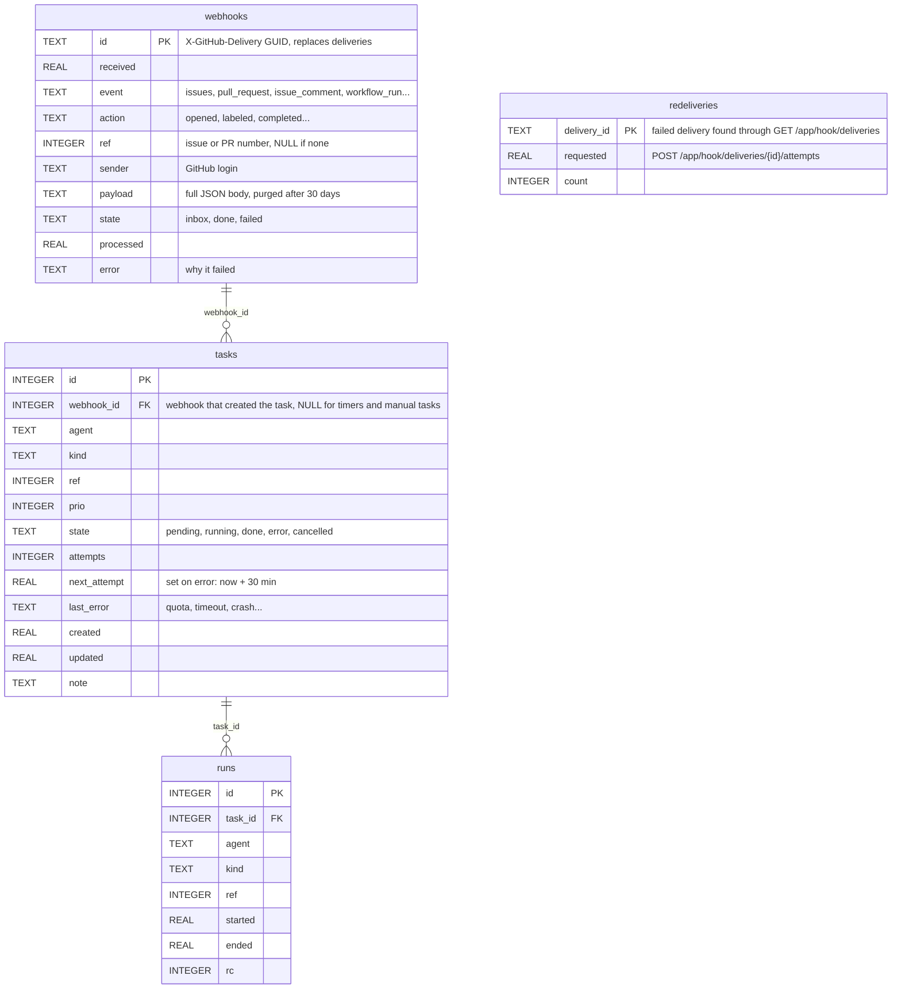

# hf-dispatch: data model

`hf-dispatch` keeps its state in one SQLite database, `/var/lib/hf-dispatch/queue.db` (owner `hf-dispatch`),
created by the service at startup (`CREATE TABLE IF NOT EXISTS`). GitHub stays the source of truth for issues,
PRs, labels and reviews: the database only holds what GitHub does not (deliveries, agent tasks and runs,
counters). `ref` always means an issue or PR number of `BarbeRouss/HouseFlow`; times are Unix seconds (UTC).
Snapshot of the current state on 2026-11-13; the target changes follow.

## Current schema

```mermaid
erDiagram
    tasks ||--o{ runs : "task_id"
    tasks {
        INTEGER id PK
        TEXT agent "product, architect, dev, review"
        TEXT kind "triage, analyse, answer, pick, request, followup, fix-ci, fix-review, fix-main, update-branch, review, functional-review, merge, verify, daily"
        INTEGER ref "issue or PR number, 0 if none"
        INTEGER prio "lower runs first"
        TEXT state "pending, running, done, failed, cancelled"
        INTEGER attempts
        REAL created
        REAL updated
        TEXT note "extra instruction given to the agent"
    }
    runs {
        INTEGER id PK
        INTEGER task_id FK
        TEXT agent
        TEXT kind
        INTEGER ref
        REAL started
        REAL ended "NULL while running"
        INTEGER rc "exit code, 0 = success, negative = killed"
    }
    deliveries {
        TEXT id PK "X-GitHub-Delivery GUID"
        REAL received
    }
    train {
        INTEGER ref PK "the single PR allowed through update and review"
    }
    adopted {
        INTEGER ref PK "PR handed over by Julien (/review, /dev...)"
    }
    fixci {
        INTEGER ref PK
        TEXT sha PK "head commit"
        INTEGER count "fix-ci tasks for this commit (max 2)"
    }
    changes {
        INTEGER ref PK
        INTEGER count "change requests on the PR (dev woken while < 4)"
    }
    asks {
        INTEGER ref PK
        TEXT agent "who set needs:julien (legacy, replaced by the GitHub label history)"
    }
    after_merge {
        INTEGER id PK
        INTEGER ref "PR or closed issue whose merge releases the task"
        TEXT agent
        TEXT kind
        INTEGER target
        TEXT note
    }
    backlog {
        INTEGER ref PK
        INTEGER pos "legacy: old PRs handed over a few at a time"
    }
    meta {
        TEXT k PK "daily"
        TEXT v "date of the last product daily"
    }
```

Notes on the current state:

- `deliveries` already de-duplicates webhooks by delivery id, but the payload is not stored: the event itself
  only lives in an in-memory queue until it is handled.
- `status.json` (same directory) is a snapshot written for the dashboard and Discord, not a source of state.
- Agent turn logs are files: `/var/lib/hf-dispatch/logs/run-<run id>-<agent>.log`.
- `asks` and `backlog` are no longer used for decisions; `after_merge` and hand-added tasks were added by Vision
  during operations and are invisible on GitHub (defect 7 of the current state).

## Target schema

Same database (SQLite, no flat files). Changes:

- **`webhooks`** replaces `deliveries`. A webhook is inserted (state `inbox`) **before** hf-dispatch answers
  GitHub; the primary key on the delivery id makes a second copy (redelivery) a no-op. Startup and the
  30-minute timer process every `inbox` row. Query for Julien: `SELECT received, event, action, ref, sender,
  state FROM webhooks ORDER BY received DESC`.
- **`tasks`**: `failed` becomes `error` with `next_attempt` and `last_error`; the timer re-queues `error` tasks
  whose `next_attempt` has passed, and Julien is told on Discord at each error. `webhook_id` tells why a task
  exists.
- **`redeliveries`**: failed GitHub deliveries already asked again, so the 30-minute timer does not loop on the
  same one.
- **Removed**: `asks` (the asker is read from the GitHub label history), `backlog` (legacy), `after_merge` and
  `adopted` if the target workflow no longer needs them (every hand-off becomes a label or a comment on GitHub).
- **To decide with the PR lifecycle**: `train` (gone if GitHub's merge queue replaces it), `fixci` and
  `changes` (counters behind the "2 fix-ci per commit" and "3 change requests" limits).
- **Unchanged**: `runs`, `meta`.
