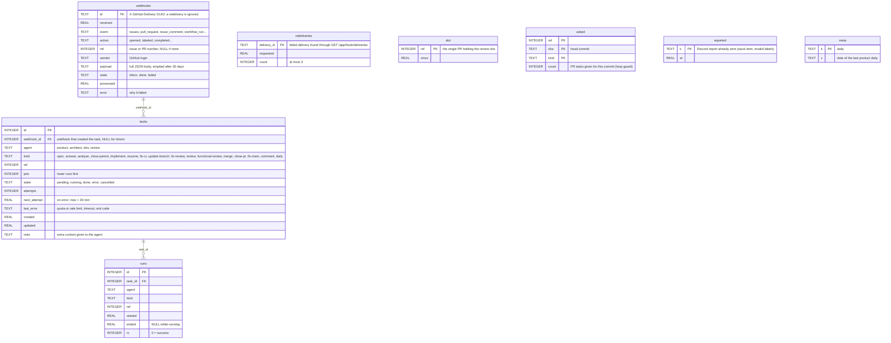

# hf-dispatch: data model

`hf-dispatch` keeps its state in one SQLite database, `/var/lib/hf-dispatch/queue.db` (owner `hf-dispatch`),
created by the service at startup. GitHub stays the source of truth for issues, PRs, labels and reviews: the
database only holds what GitHub does not (webhooks received, agent tasks and turns, the review slot, loop
guards). `ref` is an issue or PR number of `BarbeRouss/HouseFlow`; times are Unix seconds (UTC).
State of hf-dispatch v2, 2026-11-23.

- A webhook is inserted in `webhooks` (state `inbox`) **before** hf-dispatch answers GitHub; the worker then
  processes the inbox, oldest first, and at startup everything still in `inbox`. Query:
  `SELECT datetime(received,'unixepoch','localtime'), event, action, ref, sender, state FROM webhooks ORDER BY received DESC LIMIT 50`.
- A failed turn puts its task in `error`; it goes back to `pending` when `next_attempt` has passed (checked every
  30 minutes) or at the next start.
- `status.json` (same directory) is a snapshot for the dashboard and the agents; turn logs are
  `/var/lib/hf-dispatch/logs/run-<run id>-<agent>.log`.
- Left from v1, no longer used: `deliveries`, `train`, `adopted`, `asks`, `changes`, `fixci`, `after_merge`,
  `backlog`. They can be dropped once v2 has run for a while.
