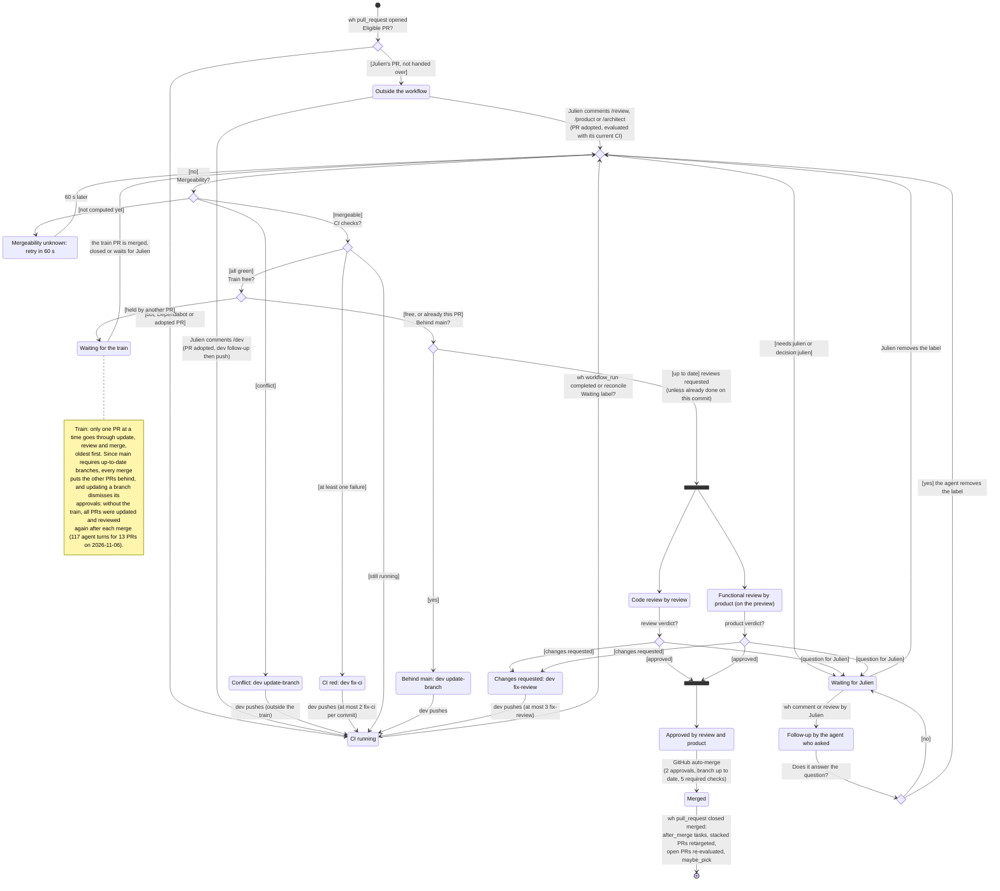
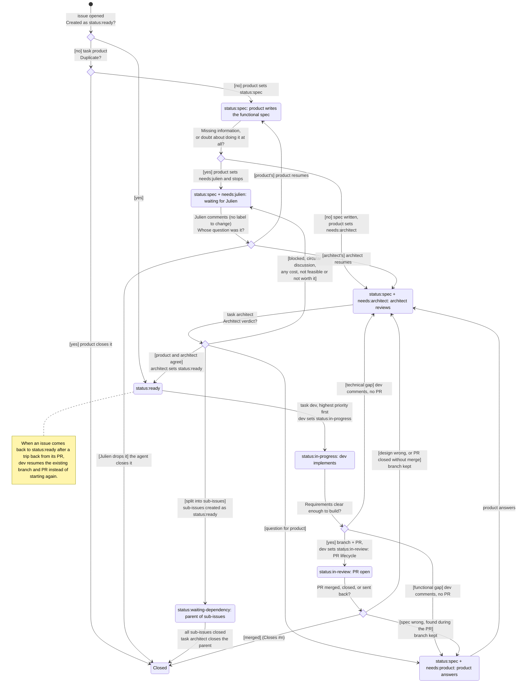

# hf-dispatch: PR and issue lifecycle (current state)

**Current** behaviour of the agent workflow as implemented in `hf-dispatch` on 2026-11-13 (AI-free service on
`houseflow-dev`, driven by GitHub webhooks). This document describes what exists today, known defects included.
Julien corrects it on this branch into the target version, which then becomes the specification for the
`hf-dispatch` tests.

The full process, with who does what, is in [`hf-dispatch-flow.bpmn`](hf-dispatch-flow.bpmn) (open it with
[bpmn.io](https://demo.bpmn.io), the bpmn-io VS Code extension or Camunda Modeler).

Trigger notation: `wh` = GitHub webhook received by hf-dispatch, `task` = task handed to an agent,
`reconcile` = hourly catch-up.

## PR lifecycle

Diamonds are **decisions** taken by `evaluate_pr` (hf-dispatch): the question is on the arrow going in, the
answers are in brackets on the arrows going out. The black bars split and join the two reviews, which run in
parallel.

A PR can be closed without merge at any time (by an agent or by Julien): hf-dispatch then only calls
`maybe_pick`.

## Issue lifecycle (current)

## Issue lifecycle (target, defined by Julien on 2026-11-13)

Linear flow. Product writes the functional spec, architect reviews it and is the only one who can make an issue
ready. dev and review are not involved before `status:ready`; once ready, dev has two exits: a PR that can be
validated, or the issue sent back to product or architect. Every kind of issue (feature, bug, tech debt) goes
through every step. The labels always tell who must act next (see *Labels*), so the work can resume from GitHub
alone.

## Labels (target)

One `status:*` and at most one `needs:*` at a time. `decision:julien` is merged into `needs:julien` (one label
for everything Julien must answer, including any cost), which makes a simple board possible.

Allowed combinations:

- `status:spec` alone (product is writing), or with exactly one of `needs:product`, `needs:architect`,
  `needs:julien`;
- `status:ready`, `status:in-progress`, `status:in-review`, `status:waiting-dependency`: alone, never with a
  `needs:*` on the issue (questions raised during a PR go on the PR, see the PR lifecycle).

Who may set what:

- product: `status:spec`, `needs:architect`, `needs:julien`; closes duplicates. Never `status:ready`.
- architect: `needs:product`, `needs:julien`, `status:ready`, `status:waiting-dependency`; creates sub-issues;
  closes a parent whose sub-issues are all closed.
- dev: `status:in-progress`, then `status:in-review` (PR opened) or `status:spec` + `needs:product` /
  `needs:architect` (no PR, or sent back from the PR).
- review: no issue label; on the PR, `needs:julien`, or a send-back to product or architect (spec or design wrong).
- Julien: only comments; the agent who asked removes `needs:julien`.

Enforcement: agents do not edit labels with raw `gh` commands. They use one command (in the `gh` wrapper of
`hf-agents`), e.g. `hf-state <n> <status> [<needs>] --reason "..."`, which checks the role, the combination and
the transition from the current state, swaps the old labels for the new ones in one go, and posts the reason
as a comment (reused by the Discord notification). Raw label edits are refused by the wrapper. hf-dispatch also
checks every labeled webhook and reports an invalid combination on Discord; it never fixes labels itself.

## Who changes labels

Only the LLM agents and Julien change workflow labels. hf-dispatch changes none (checked in the code on
2026-11-13). Two non-LLM changes exist, outside the workflow labels: the `preview` label set and removed by
the preview workflow (GitHub Actions), and the labels Dependabot puts on its own PRs. They are not notified.

## Comment routing (target)

A comment from Julien goes to the agent that owns the item in its current state: product in `status:spec`
(alone or with `needs:product`), architect with `needs:architect`, the agent who asked with `needs:julien`, dev in
`status:in-progress`, the PR lifecycle in `status:in-review`. If that agent is busy, hf-dispatch waits for the
end of its turn, then starts it again with the new comment.

## Priority (target)

dev takes ready issues by `priority:high`, then `priority:medium`, then `priority:low`, oldest first within a
level. No more hand-edited focus in the configuration.

## Delivery guarantees (target)

At-least-once, event-driven, no polling of the agents' state:

1. hf-dispatch stores every received webhook in its SQLite database (table `webhooks`, see
   [the data model](hf-dispatch-data-model.md)) **before** answering GitHub. If it cannot, it answers an error.
   On startup, every webhook not processed yet is processed.
2. GitHub does not redeliver failed webhooks by itself, and a delivery can fail for reasons other than
   hf-dispatch being stopped (network, Traefik, timeout). The webhook is configured on the **Dispatch GitHub
   App**, so every 30 minutes, and at startup, hf-dispatch lists the app's recent deliveries
   (`GET /app/hook/deliveries`, authenticated as the app) and asks for a redelivery of every failed one
   (`POST /app/hook/deliveries/{id}/attempts`). GitHub keeps deliveries for 3 days.
3. Each delivery is processed once: the `X-GitHub-Delivery` id is the primary key of `webhooks`, so a second
   copy (a redelivery keeps the same id) is ignored.
4. A task whose agent turn fails (quota exhausted, timeout, crash) goes to `error`, Julien is told on Discord,
   and the task is retried after 30 minutes, or at the next start of hf-dispatch.
5. Agents are idempotent: a task delivered twice must not do the work twice (they check the GitHub state first).

Current state for comparison: webhooks are not stored (only one log line per webhook in the journal); they go
to an in-memory queue after the HTTP answer (lost if hf-dispatch stops), a failed task is retried once right away, then marked failed with a Discord message, and nothing retries
it later.

## Discord notifications (target, defined by Julien on 2026-11-13)

Every workflow label change made by an agent (LLM) is posted in the Discord activity channel, so Julien sees
the workflow move without opening GitHub. One message per action (label events from the same actor on the same item
within a few seconds are grouped), with the actor, what changed, a link to the item and its title, and the reason
(first line of the comment the agent wrote with the change). Examples:

- **dev** set `needs:architect` on issue [#306 MCP 3/4: write tools](https://github.com/BarbeRouss/HouseFlow/issues/306):
  "the scope of update_device is unclear: which fields can be changed?"
- **architect** set `status:ready` and removed `needs:julien` on issue #350: "Julien's answer applied, spec complete."

Labels set on a PR are notified the same way as labels set on an issue (defect 2 of the current state).
`needs:julien` also mentions Julien (except at night).

## Julien's commands

- On a PR: `/review` (evaluate the PR), `/dev` (dev follow-up), `/product` (functional review),
  `/architect` (analysis). The PR is then adopted by the workflow.
- On an issue: `/dev` (dev implements it), `/product` (product answers), `/architect` (analysis).
- On an item waiting for Julien, any comment or review from Julien first goes to the agent who asked (read
  from the GitHub label history), even when it starts with a command.

## Cross-cutting rules

- One turn at a time per agent. Task priority: fix-main, fix-ci, then fix-review, review, follow-up,
  update-branch, functional-review, then answer, analyse, triage, pick, daily.
- Daily turn caps per agent (`daily_caps`), 45 min maximum per turn.
- **Train**: one PR at a time in update and review, oldest first (see the note on the PR diagram).
- Pipeline of `main` red: task dev fix-main and a Discord message.
- `reconcile` every hour: re-evaluates PRs, re-queues issues in needs:product or needs:architect and Julien's
  untriaged issues.

## Known defects of the current state

1. GitHub sends no event when a PR becomes conflicting or behind: only the merge of another PR (all open
   PRs re-evaluated) and `reconcile` detect it.
2. A `needs:julien` label set on a **PR** does not notify Julien on Discord: only `issues labeled` is
   handled, not `pull_request labeled`.
3. Beyond 2 fix-ci on the same commit or 3 change requests, the PR stays stuck with no escalation.
4. The train serialises all PRs: every merge puts the others behind ("require up-to-date branch" rule).
5. The two verdicts are evaluated independently: a verdict given before an update may refer to an older
   commit.
6. An issue in `status:in-review` without an open PR is picked up by nobody.
7. Tasks added by hand (Vision) and the `after_merge` table are not visible on GitHub.
