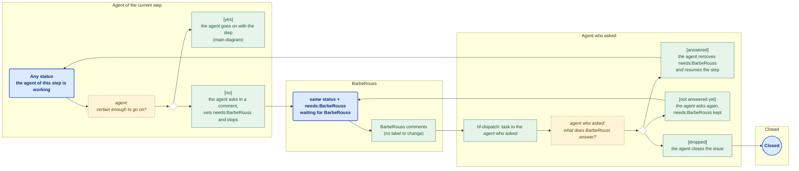

# hf-dispatch: issue and PR lifecycle (target)

**Target** behaviour of the agent workflow driven by `hf-dispatch` (AI-free service on `houseflow-dev`, driven by
GitHub webhooks), defined by BarbeRouss (Julien) on this branch. Once agreed, it is the specification of
`hf-state` and of the `hf-dispatch` tests. The current behaviour is in the git history of this file (commit
`3df54bc` and earlier) and, for now, in [`hf-dispatch-flow.bpmn`](hf-dispatch-flow.bpmn).

Notation: the diagrams read from left to right, in areas (who holds the item). Arrows carry no text, everything
is in a box.

- **Entry** (dark, pill): an event that starts the flow.
- **Status** (blue, bold, rounded): the state of the item on GitHub (labels, open or closed).
- **Question** (yellow, dashed, italic): the agent who decides and the question; it is followed by a diamond.
- **Action** (green, square): what someone does to move on; after a diamond, the answer comes first, in brackets.

`task <agent>` = turn handed to an agent by hf-dispatch.

## Issue lifecycle

Linear flow: an issue always goes through several agents, in this order: **product** (functional spec) →
**architect** (technical review, the only one who makes an issue ready) → **dev** (PR, with its own lifecycle) →
closed when the PR is merged. Every kind of issue (feature, bug, tech debt) and every sub-issue goes through
every step. The labels always tell who must act next (see *Labels*), so the work can resume from GitHub alone.
Arrows going back to the left are the trips back (questions to product or architect).

```mermaid
flowchart LR
    subgraph Input
        eWith(["Issue opened<br/>with claude"])
        eWithout(["Issue opened<br/>without claude"])
        Outside("Outside the agent flow<br/>(no claude label)")
        aAddClaude["BarbeRouss adds claude"]
    end

    subgraph Product
        aTaskProduct["hf-dispatch: task product"]
        qDuplicate["product:<br/>is it a duplicate?"]
        cDuplicate{" "}
        aCloseDuplicate["[yes]<br/>product closes the issue"]
        aSetSpec["[no]<br/>product sets status:spec"]
        Spec("status:spec<br/>product writes the functional spec")
        NeedsProduct("status:spec + needs:product<br/>product answers architect or dev")
        aSpecWritten["spec written:<br/>product sets needs:architect"]
        aProductAnswers["product answers,<br/>sets needs:architect"]
    end

    subgraph Architect
        NeedsArchitect("status:spec + needs:architect<br/>architect reviews")
        aTaskArchitect["hf-dispatch: task architect"]
        qArchitect["architect:<br/>what is the verdict?"]
        cArchitect{" "}
        aAskProduct["[question for product]<br/>architect sets needs:product"]
        aSplit["[too big]<br/>architect creates the sub-issues (with claude),<br/>sets status:waiting-dependency"]
        WaitingDependency("status:waiting-dependency<br/>split, no PR")
        aAutoClose["all sub-issues closed:<br/>hf-dispatch: task architect,<br/>architect closes the parent"]
        aSetReady["[agreed]<br/>architect sets status:ready"]
    end

    subgraph Implementation
        Ready("status:ready")
        aTaskDev["hf-dispatch: task dev (highest priority first),<br/>dev sets status:in-progress"]
        InProgress("status:in-progress<br/>dev implements")
        qClear["dev:<br/>clear enough to build?"]
        cClear{" "}
        aFunctionalGap["[functional gap]<br/>dev comments, no PR,<br/>sets status:spec + needs:product"]
        aTechnicalGap["[technical gap]<br/>dev comments, no PR,<br/>sets status:spec + needs:architect"]
        aOpenPr["[yes]<br/>dev creates branch + PR,<br/>sets status:in-review"]
        InReview("status:in-review<br/>PR lifecycle")
        qPr["How did the PR end?"]
        cPr{" "}
        aSpecWrong["[spec wrong]<br/>product puts the PR in draft,<br/>sets status:spec"]
        aDesignWrong["[design wrong]<br/>review puts the PR in draft,<br/>sets status:spec + needs:architect"]
        aMerged["[merged]<br/>GitHub closes the issue<br/>(Closes keyword in the PR)"]
        aDevBlocked["[dev blocked]<br/>dev puts the PR in draft,<br/>sets status:spec + needs:product<br/>or needs:architect"]
        aPrClosed["[closed without merge]<br/>whoever closed it sets status:spec<br/>+ needs:product / needs:architect,<br/>or closes the issue"]
    end

    subgraph Done ["Closed"]
        Closed(("Closed"))
    end

    eWithout --> Outside --> aAddClaude --> aTaskProduct
    eWith --> aTaskProduct
    aTaskProduct --> qDuplicate --> cDuplicate
    cDuplicate --> aCloseDuplicate --> Closed
    cDuplicate --> aSetSpec --> Spec --> aSpecWritten --> NeedsArchitect

    NeedsArchitect --> aTaskArchitect --> qArchitect --> cArchitect
    cArchitect --> aAskProduct --> NeedsProduct --> aProductAnswers --> NeedsArchitect
    cArchitect --> aSplit --> WaitingDependency --> aAutoClose --> Closed
    cArchitect --> aSetReady --> Ready

    Ready --> aTaskDev --> InProgress --> qClear --> cClear
    cClear --> aOpenPr --> InReview
    cClear --> aFunctionalGap --> NeedsProduct
    cClear --> aTechnicalGap --> NeedsArchitect
    InReview --> qPr --> cPr
    cPr --> aMerged --> Closed
    cPr --> aSpecWrong --> Spec
    cPr --> aDesignWrong --> NeedsArchitect
    cPr --> aDevBlocked
    aDevBlocked --> NeedsProduct
    aDevBlocked --> NeedsArchitect
    cPr --> aPrClosed
    aPrClosed --> NeedsProduct
    aPrClosed --> NeedsArchitect
    aPrClosed --> Closed

    classDef entry fill:#1f2937,stroke:#111827,color:#ffffff,font-weight:bold
    classDef status fill:#dbeafe,stroke:#1d4ed8,stroke-width:2px,color:#0b2a6b,font-weight:bold
    classDef action fill:#e6f4ea,stroke:#2f855a,color:#14532d
    classDef question fill:#fff4d6,stroke:#b7791f,stroke-dasharray:4 3,color:#5a3e00,font-style:italic
    classDef choice fill:#ffffff,stroke:#b7791f

    class eWith,eWithout entry
    class Outside,Spec,NeedsProduct,NeedsArchitect,WaitingDependency,Ready,InProgress,InReview,Closed status
    class qDuplicate,qArchitect,qClear,qPr question
    class cDuplicate,cArchitect,cClear,cPr choice
    class aAddClaude,aTaskProduct,aCloseDuplicate,aSetSpec,aSpecWritten,aProductAnswers,aTaskArchitect,aAskProduct,aSplit,aAutoClose,aSetReady,aTaskDev,aFunctionalGap,aTechnicalGap,aOpenPr,aSpecWrong,aDesignWrong,aDevBlocked,aPrClosed,aMerged action
```

When an issue comes back to `status:ready` after a trip back from its PR, dev resumes the existing branch and the
draft PR (or reopens the closed PR) instead of starting again. When BarbeRouss closes an issue whose PR is still
open, hf-dispatch wakes dev, who closes the PR.

### Waiting for BarbeRouss (at any step)

At every step, an agent who is not certain asks BarbeRouss instead of guessing. The `status:*` does not change:
the issue resumes at the same step, with the same agent. During `status:in-review` the question goes on the PR,
which goes to draft (see the PR lifecycle); once answered, the agent who asked marks the PR ready for review
again and hf-dispatch re-evaluates it from the CI step.

## Labels

- `claude`: entry gate. Only issues carrying it are handled by the agents. Set by BarbeRouss, and by architect on
  the sub-issues it creates.
- One `status:*` and at most one `needs:*` at a time. `decision:julien` and `needs:julien` are replaced by
  `needs:BarbeRouss` (one label for everything BarbeRouss must answer, including any cost).

Allowed combinations:

- `status:spec` alone (product is writing), or with exactly one of `needs:product`, `needs:architect`,
  `needs:BarbeRouss`;
- `status:ready`, `status:in-progress`, `status:waiting-dependency`: alone, or with `needs:BarbeRouss`;
- `status:in-review`: alone; questions raised during the PR go on the PR (see the PR lifecycle).

Who may set what:

- product: `status:spec`, `needs:architect`, `needs:BarbeRouss`; closes duplicates. Never `status:ready`.
  From a PR whose spec is wrong: puts the PR in draft and sets `status:spec` on the issue.
- architect: `needs:product`, `needs:BarbeRouss`, `status:ready`, `status:waiting-dependency`; creates sub-issues
  (with `claude`); closes a parent whose sub-issues are all closed.
- dev: `status:in-progress`, then `status:in-review` (PR opened) or `status:spec` + `needs:product` /
  `needs:architect` (no PR); `needs:BarbeRouss` on the issue or the PR.
- review: on the PR, `needs:BarbeRouss`. From a PR whose design is wrong: puts the PR in draft and sets
  `status:spec` + `needs:architect` on the issue.
- BarbeRouss: adds `claude`, otherwise only comments; the agent who asked removes `needs:BarbeRouss`.

Enforcement: agents do not edit labels with raw `gh` commands. They use one command (in the `gh` wrapper of
`hf-agents`), e.g. `hf-state <n> <status> [<needs>] --reason "..."`, which checks the role, the combination and
the transition from the current state, swaps the old labels for the new ones in one go, and posts the reason
as a comment (reused by the Discord notification). Raw label edits are refused by the wrapper. hf-dispatch also
checks every labeled webhook and reports an invalid combination on Discord; it never fixes labels itself.

## Who changes labels

Only the LLM agents and BarbeRouss change workflow labels. hf-dispatch changes none. Two non-LLM changes exist,
outside the workflow labels: the `preview` label set and removed by the preview workflow (GitHub Actions), and the
labels Dependabot puts on its own PRs. They are not notified.

More generally, **hf-dispatch stays dumb**: it reads GitHub (webhooks, API) and wakes agents, nothing else. It never
writes to GitHub: no label, no comment, no close, no `@dependabot rebase`. Every action on GitHub, even a
deterministic one (closing a parent whose sub-issues are closed, closing the PR of a closed issue), is a task given
to an agent, so that the agent's judgement applies and the change is notified like any other.

## Comment routing

A comment from BarbeRouss goes to the agent that owns the item in its current state: product in `status:spec`
(alone or with `needs:product`), architect with `needs:architect`, the agent who asked with `needs:BarbeRouss`,
dev in `status:in-progress`, and dev for a comment on a PR (dev owns the PR). If that agent is busy, hf-dispatch
waits for the end of its turn, then starts it again with the new comment.

## Priority

dev takes ready issues by `priority:high`, then `priority:medium`, then `priority:low`, oldest first within a
level. No more hand-edited focus in the configuration.

## Delivery guarantees

At-least-once, event-driven, no polling of the agents' state:

1. hf-dispatch stores every received webhook in its SQLite database (table `webhooks`, see
   [the data model](hf-dispatch-data-model.md)) **before** answering GitHub. If it cannot, it answers an error.
   On startup, every webhook not processed yet is processed.
2. GitHub does not redeliver failed webhooks by itself, and a delivery can fail for reasons other than
   hf-dispatch being stopped (network, Traefik, timeout). The webhook is configured on the **Dispatch GitHub
   App**, so every 30 minutes, and at startup, hf-dispatch lists the app's recent deliveries
   (`GET /app/hook/deliveries`, authenticated as the app) and asks for a redelivery of every failed one
   (`POST /app/hook/deliveries/{id}/attempts`). GitHub keeps deliveries for 3 days.
3. Each delivery is processed once: the `X-GitHub-Delivery` id is the primary key of `webhooks`, so a second
   copy (a redelivery keeps the same id) is ignored.
4. A task whose agent turn fails (quota exhausted, timeout, crash) goes to `error`, BarbeRouss is told on
   Discord, and the task is retried after 30 minutes, or at the next start of hf-dispatch.
5. Agents are idempotent: a task delivered twice must not do the work twice (they check the GitHub state first).

## Discord notifications

Every workflow label change made by an agent (LLM) is posted in the Discord activity channel, so BarbeRouss sees
the workflow move without opening GitHub. One message per action (label events from the same actor on the same
item within a few seconds are grouped), with the actor, what changed, a link to the item and its title, and the
reason (first line of the comment the agent wrote with the change). Examples:

- **dev** set `needs:architect` on issue [#306 MCP 3/4: write tools](https://github.com/BarbeRouss/HouseFlow/issues/306):
  "the scope of update_device is unclear: which fields can be changed?"
- **architect** set `status:ready` and removed `needs:BarbeRouss` on issue #350: "BarbeRouss's answer applied,
  spec complete."

Labels set on a PR are notified the same way as labels set on an issue. `needs:BarbeRouss` also mentions
BarbeRouss (except at night).

## PR lifecycle

Starts when dev opens the PR (issue in `status:in-review`) or when Dependabot opens one (no issue). Autonomous:
BarbeRouss is not needed to merge, and never opens a PR. dev owns the PR until it is green: it runs the unit tests
locally and pushes, GitHub Actions run the E2E tests and deploy the preview (`https://<n>.pr.houseflow.cloud`).
Once the CI is green, the PR waits for the **review slot**; review (code) and product (functional, in a browser on
the preview) then review it in parallel. When both approve, GitHub auto-merge merges it, and the merge closes the
issue (`Closes #n`).

Whenever the PR needs dev again (CI red, conflict, changes requested), dev takes it back. When dev is blocked, the
PR goes to draft: it blocks nothing and dev is free to work on another issue.

```mermaid
flowchart LR
    subgraph Dev
        eOpened(["dev opened the PR<br/>issue in status:in-review"])
        eDependabot(["Dependabot opened a PR<br/>(no issue)"])
        aFixCi["[checks red]<br/>hf-dispatch: task dev fix-ci"]
        aConflict["[conflict with main]<br/>hf-dispatch: task dev update-branch<br/>(Dependabot PR: @dependabot rebase)"]
        aFixReview["[changes requested]<br/>hf-dispatch frees the slot,<br/>task dev fix-review<br/>(both sets of comments)"]
        qFixable["dev:<br/>can I fix it?"]
        cFixable{" "}
        aPush["[yes]<br/>dev runs the unit tests locally,<br/>pushes"]
        aPark["[no, blocked]<br/>dev puts the PR in draft,<br/>sets the right needs:*"]
        aBehind["[behind main]<br/>hf-dispatch: task dev update-branch<br/>(slot kept)"]
        aUpdate["dev merges main,<br/>runs the unit tests, pushes"]
    end

    subgraph CI ["CI (GitHub Actions)"]
        CiRunning("CI running<br/>build, unit, integration, E2E,<br/>preview deployed")
        qCi["hf-dispatch:<br/>checks and mergeability?"]
        cCi{" "}
    end

    subgraph Slot ["Review slot (one PR at a time)"]
        qSlot["hf-dispatch:<br/>review slot free,<br/>or already this PR?"]
        cSlot{" "}
        aWaitSlot["[held by another PR]<br/>queued: fix-main first,<br/>then issue priority, then oldest"]
        WaitSlot("Waiting for the review slot<br/>dev free for another issue")
        aTakeSlot["[free]<br/>hf-dispatch gives the slot<br/>to this PR"]
        qBehind["hf-dispatch:<br/>up to date with main?"]
        cBehind{" "}
        aRequestReviews["[up to date]<br/>hf-dispatch: task review<br/>and task product"]
    end

    subgraph Reviews
        qReview["review:<br/>is the code right?"]
        cReview{" "}
        qProduct["product:<br/>does it work on the preview<br/>(browser)?"]
        cProduct{" "}
        aReviewVerdict["review approves,<br/>requests changes<br/>or sends back"]
        aProductVerdict["product approves,<br/>requests changes<br/>or sends back"]
        qBoth["hf-dispatch:<br/>both verdicts in<br/>on this commit?"]
        cBoth{" "}
        aWaitOther["[not yet]<br/>wait for the other verdict"]
        qVerdicts["hf-dispatch:<br/>what are the verdicts?"]
        cVerdicts{" "}
    end

    subgraph Merge
        Approved("Approved<br/>by review and product")
        aAutoMerge["GitHub auto-merge<br/>(2 approvals, up to date,<br/>required checks green),<br/>slot freed"]
    end

    subgraph Parked ["Draft: blocks nothing"]
        aSendBack["[sent back]<br/>product (spec wrong) or review (design wrong)<br/>puts the PR in draft, sets status:spec<br/>(+ needs:architect for design)<br/>Dependabot PR: closed instead"]
        Draft("PR in draft<br/>slot freed, dev free")
        aResume["issue ready again:<br/>hf-dispatch: task dev resume<br/>(counts in the 3-PR limit)"]
        aAnswered["BarbeRouss answered:<br/>the agent who asked<br/>removes needs:BarbeRouss"]
        aReadyForReview["the agent marks the PR<br/>ready for review"]
    end

    subgraph Done ["Closed"]
        Merged(("Merged<br/>issue closed"))
    end

    eOpened --> CiRunning
    eDependabot --> CiRunning
    CiRunning --> qCi --> cCi
    cCi --> aFixCi --> qFixable
    cCi --> aConflict --> qFixable
    cCi --> qSlot
    qFixable --> cFixable
    cFixable --> aPush --> CiRunning
    cFixable --> aPark --> Draft

    qSlot --> cSlot
    cSlot --> aWaitSlot --> WaitSlot --> qCi
    cSlot --> aTakeSlot --> qBehind --> cBehind
    cBehind --> aBehind --> aUpdate --> CiRunning
    cBehind --> aRequestReviews

    aRequestReviews --> qReview --> cReview --> aReviewVerdict --> qBoth
    aRequestReviews --> qProduct --> cProduct --> aProductVerdict --> qBoth
    qBoth --> cBoth
    cBoth --> aWaitOther
    cBoth --> qVerdicts --> cVerdicts
    cVerdicts --> Approved --> aAutoMerge --> Merged
    cVerdicts --> aFixReview --> qFixable
    cVerdicts --> aSendBack --> Draft

    Draft --> aResume --> aReadyForReview
    Draft --> aAnswered --> aReadyForReview
    aReadyForReview --> qCi

    classDef entry fill:#1f2937,stroke:#111827,color:#ffffff,font-weight:bold
    classDef status fill:#dbeafe,stroke:#1d4ed8,stroke-width:2px,color:#0b2a6b,font-weight:bold
    classDef action fill:#e6f4ea,stroke:#2f855a,color:#14532d
    classDef question fill:#fff4d6,stroke:#b7791f,stroke-dasharray:4 3,color:#5a3e00,font-style:italic
    classDef choice fill:#ffffff,stroke:#b7791f

    class eOpened,eDependabot entry
    class CiRunning,WaitSlot,Approved,Draft,Merged status
    class qFixable,qCi,qSlot,qBehind,qReview,qProduct,qBoth,qVerdicts question
    class cFixable,cCi,cSlot,cBehind,cReview,cProduct,cBoth,cVerdicts choice
    class aFixCi,aConflict,aFixReview,aPush,aPark,aBehind,aUpdate,aWaitSlot,aTakeSlot,aRequestReviews,aReviewVerdict,aProductVerdict,aWaitOther,aAutoMerge,aSendBack,aResume,aAnswered,aReadyForReview action
```

Rules:

- **Review slot**: only the review step is locked, one PR at a time. `main` requires up-to-date branches and
  updating a branch dismisses its approvals: without the lock, every merge would put the other PRs behind and send
  them back to review. The PR holding the slot is brought up to date first (the update is inside the slot), then
  reviewed, then merged. Quality first: throughput is limited to one PR per update + CI + reviews cycle.
- **Slot queue**: a PR that fixes a red `main` (`fix-main`) goes first, then issue priority (`priority:high` >
  `medium` > `low`; Dependabot PRs count as `low`), then oldest first.
- **The slot is freed** as soon as the PR no longer waits for its reviewers: merged, changes requested, CI red or
  conflict after an update, draft, `needs:BarbeRouss`, closed. hf-dispatch then gives it to the next green PR. A
  PR that lost the slot after changes requested is reviewed again anyway, so losing its place costs nothing.
- **Verdicts**: a review or product turn on a PR always ends with a verdict: approve, request changes, or send
  back; a plain comment is not a verdict and hf-dispatch asks again. Verdicts are short turns: the reviewers
  unblock the slot quickly, they do not defer. hf-dispatch waits for **both** verdicts before acting, so dev gets
  both sets of comments in one `fix-review` and nobody reviews a commit that is about to change. Any send-back
  wins over the other verdict; otherwise any request changes wins over an approve.
- **Draft blocks nothing**: a PR in draft is ignored by hf-dispatch and never holds the slot. dev puts the PR in
  draft when it is blocked, with the right `needs:*`: `needs:BarbeRouss` on the PR, or `status:spec` +
  `needs:product` / `needs:architect` on the issue. product (spec wrong) and review (design wrong) do the same.
  Leaving draft is always done by an agent (`ready for review`), then hf-dispatch re-evaluates the PR from the CI
  step: it goes through the slot queue again.
- **needs:BarbeRouss**: dev, review and product may set it on the PR at any step (see *Waiting for BarbeRouss*);
  the PR goes to draft and frees the slot. Once answered, the agent who asked removes the label and marks the PR
  ready for review.
- **Loops**: no hard cap. The agent sets `needs:BarbeRouss` when it goes round in circles: the same check still red
  after 2 `fix-ci`, or a 3rd round of change requests. hf-dispatch counts them from GitHub (failed runs per head
  commit, `CHANGES_REQUESTED` reviews) and says it in the task.
- **New commit**: any push that changes the diff (fix-ci, fix-review, conflict) asks for both reviews again.
- **Closing without merge**: anyone (an agent or BarbeRouss) may close a PR, as long as the issue reflects it in
  the same move: `status:spec` + `needs:product` / `needs:architect` (work to redo, branch kept) or the issue
  closed (dropped). If BarbeRouss closes the issue first, hf-dispatch wakes dev, who closes its PR. hf-dispatch
  reports on Discord an issue left in `status:in-review` with no open PR.
- **Dependabot PRs** follow the same lifecycle, without an issue: no `status:*`, send-back = close the PR with a
  comment. dev never pushes on a Dependabot branch (Dependabot would stop maintaining it): dev's `update-branch`
  turn is a `@dependabot rebase` comment. product's functional review is a smoke test of the preview.

## dev work list

dev works on one turn at a time but can have several PRs in flight: while a PR waits (CI running, waiting for the
slot, in review, in draft), dev is free to start the next item. hf-dispatch keeps dev's work list (table `tasks`,
rebuilt from GitHub at startup, GitHub stays the source of truth), in this order:

1. PRs that need dev: CI red, conflict, behind main while holding the slot, changes requested. A PR already in
   flight always comes before new work.
2. Draft PRs to resume: issue back in `status:ready`.
3. New issues in `status:ready`: `priority:high`, then `priority:medium`, then `priority:low`, oldest first.

**Limit: 3 non-draft PRs opened by dev** (Dependabot PRs do not count). Items 2 and 3 wait while dev is at the
limit; item 1 is always taken. This is the backpressure of the slot: dev stops opening PRs when the queue is
full, and the agents that review them catch up.

dev does not wait inside a turn: it pushes and ends its turn; hf-dispatch wakes it up again from the webhooks (CI
result, review verdict).
