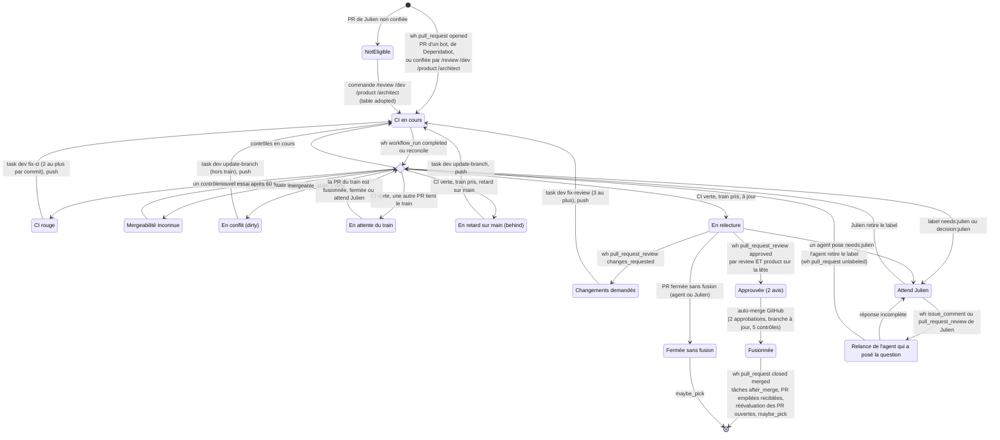
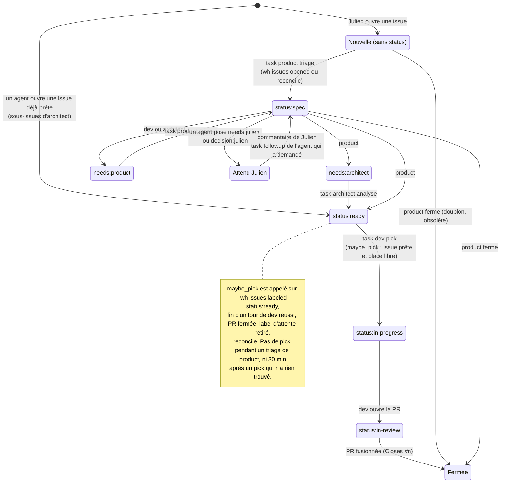

# hf-dispatch : états d'une PR et d'une issue (existant)

État **actuel** du circuit des agents, tel que le code de `hf-dispatch` le gère le 13/11/2026
(service sans IA sur `houseflow-dev`, déclenché par les webhooks GitHub). Ce document décrit
l'existant, défauts compris : la version cible sera corrigée par Julien sur cette branche, puis
servira de spécification aux tests de `hf-dispatch`.

Le processus complet, avec qui fait quoi, est dans [`hf-dispatch-flow.bpmn`](hf-dispatch-flow.bpmn)
(à ouvrir avec [bpmn.io](https://demo.bpmn.io) ou Camunda Modeler).

Légende des déclencheurs : `wh:` webhook GitHub reçu par hf-dispatch, `task:` tâche confiée à un
agent, `reconcile` rattrapage horaire.

## Cycle de vie d'une PR

## Cycle de vie d'une issue

## Commandes de Julien

- Sur une PR : `/review` (évalue la PR), `/dev` (followup de dev), `/product` (relecture
  fonctionnelle), `/architect` (analyse). La PR est alors « adoptée » par le circuit.
- Sur une issue : `/dev` (dev l'implémente), `/product` (product répond), `/architect` (analyse).
- Sur un élément qui attend Julien, tout commentaire ou avis de Julien part d'abord à l'agent qui a
  posé la question (lu dans l'historique GitHub), même s'il commence par une commande.

## Règles transverses

- Un tour à la fois par agent ; priorité des tâches : fix-main, fix-ci, puis fix-review, review,
  followup, update-branch, functional-review, puis answer, analyse, triage, pick, daily.
- Plafonds de tours par agent et par jour (`daily_caps`), délai maximal d'un tour 45 min.
- **Train** : une seule PR à la fois en mise à jour et en relecture, la plus ancienne d'abord.
- Pipeline de `main` en échec : task dev fix-main et message Discord.
- `reconcile` toutes les heures : réévalue les PR, relance les issues en needs:product,
  needs:architect et les issues de Julien non triées.

## Défauts connus de l'existant

1. GitHub n'envoie aucun événement quand une PR passe en conflit ou en retard : seuls la fusion
   d'une autre PR (réévaluation de toutes les PR) et `reconcile` le détectent.
2. Un label `needs:julien` posé sur une **PR** ne prévient pas Julien sur Discord : seul
   l'événement `issues labeled` est traité, pas `pull_request labeled`.
3. Au-delà de 2 fix-ci sur le même commit ou de 3 demandes de changements, la PR reste bloquée
   sans escalade.
4. Le train sérialise toutes les PR : chaque fusion remet les autres en retard (règle « branche
   à jour obligatoire »).
5. Les deux avis (review, product) sont évalués séparément, sans point de jonction : un avis
   arrivé après une mise à jour peut porter sur un ancien commit.
6. Une issue `status:in-review` sans PR ouverte n'est reprise par personne.
7. Les tâches ajoutées à la main (Vision) et la table `after_merge` ne sont pas visibles sur GitHub.
