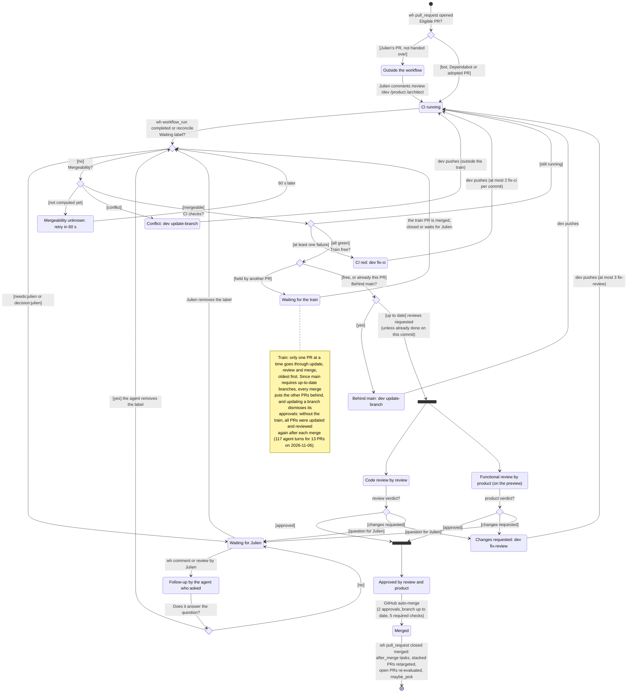
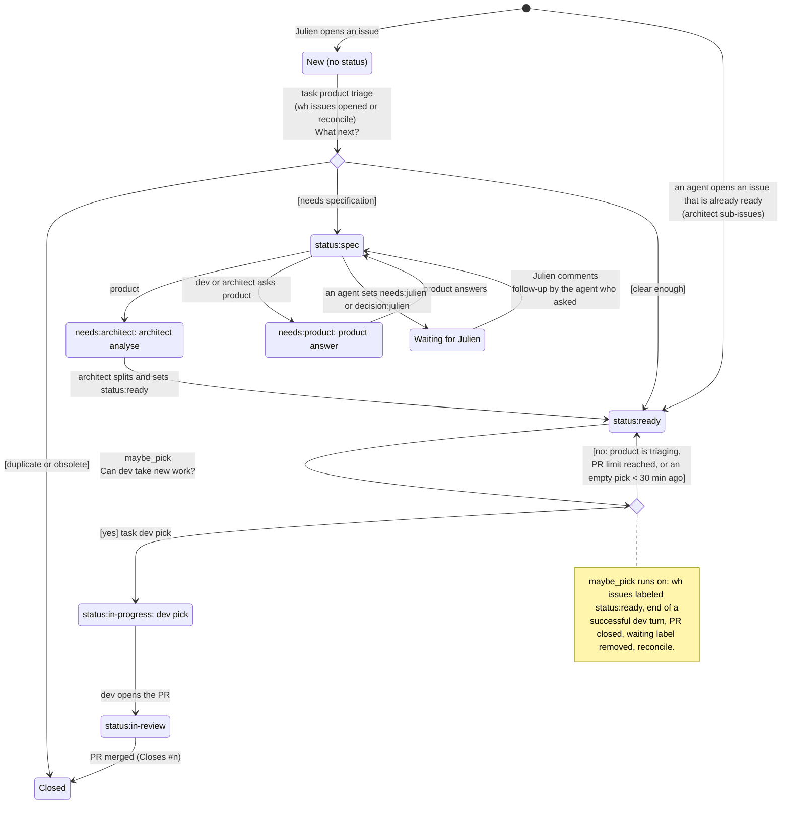
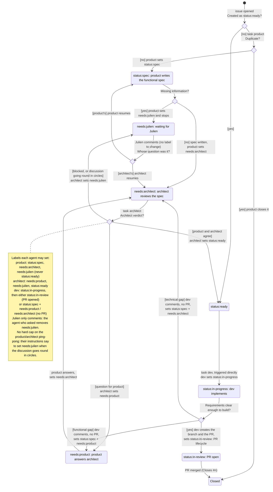

# hf-dispatch: PR and issue lifecycle (current state)

**Current** behaviour of the agent workflow as implemented in `hf-dispatch` on 2026-11-13 (AI-free service on
`houseflow-dev`, driven by GitHub webhooks). This document describes what exists today, known defects included.
Julien corrects it on this branch into the target version, which then becomes the specification for the
`hf-dispatch` tests.

The full process, with who does what, is in [`hf-dispatch-flow.bpmn`](hf-dispatch-flow.bpmn) (open it with
[bpmn.io](https://demo.bpmn.io), the bpmn-io VS Code extension or Camunda Modeler).

Trigger notation: `wh` = GitHub webhook received by hf-dispatch, `task` = task handed to an agent,
`reconcile` = hourly catch-up.

## PR lifecycle

Diamonds are **decisions** taken by `evaluate_pr` (hf-dispatch): the question is on the arrow going in, the
answers are in brackets on the arrows going out. The black bars split and join the two reviews, which run in
parallel.

A PR can be closed without merge at any time (by an agent or by Julien): hf-dispatch then only calls
`maybe_pick`.

## Issue lifecycle (current)

## Issue lifecycle (target, defined by Julien on 2026-11-13)

Linear flow. Product writes the functional spec, architect reviews it and is the only one who can make an issue
ready. dev and review are not involved before `status:ready`; once ready, dev has two exits: a PR that can be
validated, or the issue sent back to product or architect. The waiting labels (`needs:product`,
`needs:architect`, `needs:julien`) always tell who must act next, so the work can resume from GitHub alone.

## Julien's commands

- On a PR: `/review` (evaluate the PR), `/dev` (dev follow-up), `/product` (functional review),
  `/architect` (analysis). The PR is then adopted by the workflow.
- On an issue: `/dev` (dev implements it), `/product` (product answers), `/architect` (analysis).
- On an item waiting for Julien, any comment or review from Julien first goes to the agent who asked (read
  from the GitHub label history), even when it starts with a command.

## Cross-cutting rules

- One turn at a time per agent. Task priority: fix-main, fix-ci, then fix-review, review, follow-up,
  update-branch, functional-review, then answer, analyse, triage, pick, daily.
- Daily turn caps per agent (`daily_caps`), 45 min maximum per turn.
- **Train**: one PR at a time in update and review, oldest first (see the note on the PR diagram).
- Pipeline of `main` red: task dev fix-main and a Discord message.
- `reconcile` every hour: re-evaluates PRs, re-queues issues in needs:product or needs:architect and Julien's
  untriaged issues.

## Known defects of the current state

1. GitHub sends no event when a PR becomes conflicting or behind: only the merge of another PR (all open
   PRs re-evaluated) and `reconcile` detect it.
2. A `needs:julien` label set on a **PR** does not notify Julien on Discord: only `issues labeled` is
   handled, not `pull_request labeled`.
3. Beyond 2 fix-ci on the same commit or 3 change requests, the PR stays stuck with no escalation.
4. The train serialises all PRs: every merge puts the others behind ("require up-to-date branch" rule).
5. The two verdicts are evaluated independently: a verdict given before an update may refer to an older
   commit.
6. An issue in `status:in-review` without an open PR is picked up by nobody.
7. Tasks added by hand (Vision) and the `after_merge` table are not visible on GitHub.
